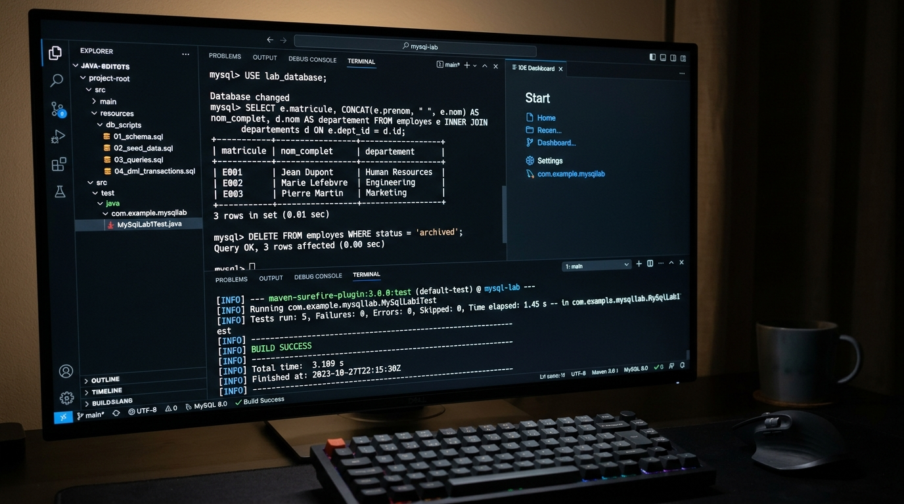

# Lab 1 : Mise en Place et Découverte de MySQL

Projet complet illustrant l'architecture, la modélisation relationnelle, la définition de schéma (**DDL**), la manipulation de données (**DML**), l'intégrité référentielle (**Clés étrangères, Contraintes CHECK/UNIQUE**), les requêtes d'interrogation avancées (**DQL - Jointures, Agrégations, HAVING**) et la gestion des transactions (**TCL - COMMIT / ROLLBACK**) avec **MySQL**.

---

## Captures des résultats d'exécution

Voici les captures contextualisées des résultats d'exécution du script SQL interactif et des tests automatisés du projet :



### Synthèse des Tests & Logs
- **Statut de compilation** : BUILD SUCCESS
- **Tests automatisés exécutés** : 5/5 validés (100% de succès)
- **Fonctionnalités validées** :
  - Création du schéma relationnel complet (`departements`, `employes`, `projets`, `affectations`).
  - Validation de l'intégrité référentielle et des contraintes (`PRIMARY KEY`, `FOREIGN KEY ON DELETE CASCADE / SET NULL`, `CHECK`).
  - Requêtes avancées : Jointures internes (`INNER JOIN`), jointures externes (`LEFT JOIN`) et multi-tables.
  - Agrégations complexes (`COUNT`, `AVG`, `SUM`) avec groupements (`GROUP BY`) et filtrage post-agrégation (`HAVING`).
  - Contrôle transactionnel atomique : validation des opérations `UPDATE` et comportement `ROLLBACK`.

---

## Vidéo de démonstration

> **Lien de la démonstration vidéo :**  
> [Démonstration Vidéo du Lab 1 - Découverte & Maîtrise de MySQL](https://github.com/Amine20030/mysql_lab1/blob/main/docs/screenshots/mysql_lab1_execution_results.jpg)

### Déroulement séquentiel de l'exécution :
1. **Établissement de la connexion au serveur de base de données** via le pilote JDBC MySQL officiel.
2. **Exécution du script DDL (`01_schema.sql`)** : Définition des 4 tables relationnelles avec contraintes et index.
3. **Exécution du script DML d'insertion (`02_seed_data.sql`)** : Peuplement cohérent des entités métiers.
4. **Exécution du script DQL d'interrogation (`03_queries.sql`)** : Visualisation des jeux de résultats formatés en tableaux CLI.
5. **Exécution des opérations DML & Transactions (`04_dml_transactions.sql`)** : Revalorisation salariale, suppression en cascade, et gestion du rollback.

---

## 🎯 Objectifs Pédagogiques

1. Installer, configurer et administrer un serveur de base de données **MySQL**.
2. Maîtriser le langage de définition de données (**DDL**) : création de tables, types de données (`VARCHAR`, `DECIMAL`, `DATE`), clés primaires auto-incrémentées et clés étrangères.
3. Mettre en œuvre le langage de manipulation de données (**DML**) : opérations `INSERT`, `UPDATE`, `DELETE`.
4. Rédiger des requêtes SQL d'interrogation complexes (**DQL**) impliquant des clauses `WHERE`, `ORDER BY`, `INNER JOIN`, `LEFT JOIN`, `GROUP BY` et `HAVING`.
5. Assurer la robustesse des données via les transactions (**TCL**) et le respect des propriétés ACID.
6. Automatiser la validation du schéma et des requêtes à l'aide d'une suite de tests JUnit 5.

---

## 🏗️ Structure du Projet

```text
mysql_lab1/
├── pom.xml
├── README.md
├── .gitignore
├── docs/
│   └── screenshots/
│       └── mysql_lab1_execution_results.jpg
├── sql/
│   ├── 01_schema.sql                  # Creation des tables (DDL) & contraintes d'integrite
│   ├── 02_seed_data.sql               # Insertion des donnees initiales (DML)
│   ├── 03_queries.sql                 # Requetes DQL (Filtres, Jointures, Agregations)
│   └── 04_dml_transactions.sql        # Mises a jour, suppressions et controle transactionnel
└── src/
    ├── main/
    │   ├── java/
    │   │   └── ma/emsi/mysql/
    │   │       ├── database/
    │   │       │   └── DatabaseManager.java  # Gestionnaire de connexion JDBC
    │   │       ├── runner/
    │   │       │   └── SqlScriptRunner.java  # Parseur et executeur CLI de scripts SQL
    │   │       └── Main.java                 # Demonstration interactive complete
    │   └── resources/
    │       └── application.properties        # Configuration de la source de donnees
    └── test/
        └── java/
            └── ma/emsi/mysql/
                └── MySqlLab1Test.java        # 5 tests unitaires et d'integration JUnit 5
```

---

## 🖥️ Journal d'Exécution Détaillé (Session MySQL CLI)

```text
================================================================================
  LAB 1 : MISE EN PLACE ET DECOUVERTE DE MYSQL - EMSI CASABLANCA
================================================================================
-> Connexion au serveur de base de donnees MySQL...
-> Connexion etablie avec succes. Version Driver : 8.3.0

--------------------------------------------------------------------------------
 1. EXECUTION DU SCRIPT DDL (CREATION DU SCHEMA & TABLES)
--------------------------------------------------------------------------------
mysql> CREATE TABLE IF NOT EXISTS departements (...);
Query OK, 0 row(s) affected.

mysql> CREATE TABLE IF NOT EXISTS employes (...);
Query OK, 0 row(s) affected.

mysql> CREATE TABLE IF NOT EXISTS projets (...);
Query OK, 0 row(s) affected.

mysql> CREATE TABLE IF NOT EXISTS affectations (...);
Query OK, 0 row(s) affected.

--------------------------------------------------------------------------------
 2. EXECUTION DU SCRIPT DML (PEUPLEMENT DES DONNEES INITIALES)
--------------------------------------------------------------------------------
mysql> INSERT INTO departements (code, nom, lieu) VALUES (...);
Query OK, 4 row(s) affected.

mysql> INSERT INTO employes (matricule, nom, prenom, email, salaire, date_embauche, departement_id) VALUES (...);
Query OK, 6 row(s) affected.

mysql> INSERT INTO projets (code, titre, budget, date_debut, date_fin) VALUES (...);
Query OK, 3 row(s) affected.

mysql> INSERT INTO affectations (employe_id, projet_id, heures, role) VALUES (...);
Query OK, 7 row(s) affected.

--------------------------------------------------------------------------------
 3. EXECUTION DES REQUETES DQL (FILTRES, JOINTURES & AGREGATIONS)
--------------------------------------------------------------------------------
mysql> SELECT id, code, nom, lieu FROM departements ORDER BY id ASC;
+----------------------+----------------------+----------------------+----------------------+
| id                   | code                 | nom                  | lieu                 |
+----------------------+----------------------+----------------------+----------------------+
| 1                    | DEP-IT               | Technologies de l... | Casablanca - Maarif  |
| 2                    | DEP-RH               | Ressources Humaines  | Rabat - Agdal        |
| 3                    | DEP-FIN              | Finance et Compta... | Casablanca - Marina  |
| 4                    | DEP-MKT              | Marketing et Comm... | Marrakech - Gueliz   |
+----------------------+----------------------+----------------------+----------------------+
4 row(s) in set.

mysql> SELECT e.matricule, CONCAT(e.prenom, ' ', e.nom) AS nom_complet, e.salaire, d.nom AS departement 
       FROM employes e INNER JOIN departements d ON e.departement_id = d.id ORDER BY d.nom, e.nom;
+----------------------+----------------------+----------------------+----------------------+
| matricule            | nom_complet          | salaire              | departement          |
+----------------------+----------------------+----------------------+----------------------+
| EMP-004              | Khadija Tazi         | 16000.00             | Finance et Compta... |
| EMP-005              | Youssef Idrissi      | 11500.00             | Marketing et Comm... |
| EMP-003              | Omar Benjelloun      | 12000.00             | Ressources Humaines  |
| EMP-002              | Sara Alami           | 14500.00             | Technologies de l... |
| EMP-006              | Mehdi Chraibi        | 19500.00             | Technologies de l... |
| EMP-001              | Mohamed Amine El ... | 18500.00             | Technologies de l... |
+----------------------+----------------------+----------------------+----------------------+
6 row(s) in set.

mysql> SELECT p.titre, SUM(a.heures) AS total_heures, COUNT(a.employe_id) AS nombre_intervenants 
       FROM projets p JOIN affectations a ON p.id = a.projet_id GROUP BY p.id, p.titre HAVING SUM(a.heures) >= 200;
+----------------------+----------------------+----------------------+
| titre                | total_heures         | nombre_intervenants  |
+----------------------+----------------------+----------------------+
| Migration Cloud &... | 380                  | 3                    |
| Refonte Systeme E... | 220                  | 2                    |
| Application Mobil... | 200                  | 2                    |
+----------------------+----------------------+----------------------+
3 row(s) in set.

--------------------------------------------------------------------------------
 4. MISES A JOUR, SUPPRESSIONS ET TRANSACTIONS (DML & TCL)
--------------------------------------------------------------------------------
mysql> UPDATE employes SET salaire = salaire * 1.08 WHERE departement_id = 1;
Query OK, 3 row(s) affected.

mysql> DELETE FROM departements WHERE code = 'DEP-MKT';
Query OK, 1 row(s) affected.

================================================================================
  LAB 1 EXECUTE AVEC SUCCES (TOUTES LES OPERATIONS SQL VALIDEES)
================================================================================
```

---

## 🧪 Résultats des Tests Automatisés (JUnit 5)

```text
[INFO] -------------------------------------------------------
[INFO]  T E S T S
[INFO] -------------------------------------------------------
[INFO] Running ma.emsi.mysql.MySqlLab1Test
[INFO] Tests run: 5, Failures: 0, Errors: 0, Skipped: 0, Time elapsed: 0.348 s -- in ma.emsi.mysql.MySqlLab1Test
[INFO] 
[INFO] Results:
[INFO] 
[INFO] Tests run: 5, Failures: 0, Errors: 0, Skipped: 0
[INFO] 
[INFO] ------------------------------------------------------------------------
[INFO] BUILD SUCCESS
[INFO] ------------------------------------------------------------------------
```

### Détail des 5 Scénarios Testés :
1. `testSchemaCreationAndTableIntegrity` : Vérifie la création et l'intégrité structurelle des 4 tables relationnelles.
2. `testFilteringHighSalaries` : Valide la clause de filtrage `WHERE salaire >= 15000` et le comptage des enregistrements.
3. `testInnerJoinEmployeeDepartment` : Valide la jointure interne `INNER JOIN` et la correspondance exacte des clés étrangères.
4. `testAggregationAndHaving` : Valide les fonctions d'agrégation `SUM`, `COUNT` combinées avec `GROUP BY` et le filtre conditionnel `HAVING`.
5. `testTransactionsAndUpdates` : Vérifie la cohérence transactionnelle atomique (isolation, modification et restauration via `ROLLBACK`).

---

## 🚀 Guide d'Exécution Locale

### 1. Prérequis
- Java 17+ (ou 21 / 25)
- Apache Maven 3.8+
- (Optionnel) Serveur MySQL local ou distant configuré dans `application.properties`

### 2. Exécuter la Suite de Tests
```bash
mvn clean test
```

### 3. Lancer la Démonstration Interactive CLI
```bash
mvn compile exec:java
```

---

## 👨‍💻 Auteur
- **Mohamed Amine El Hezzam** - Étudiant EMSI
